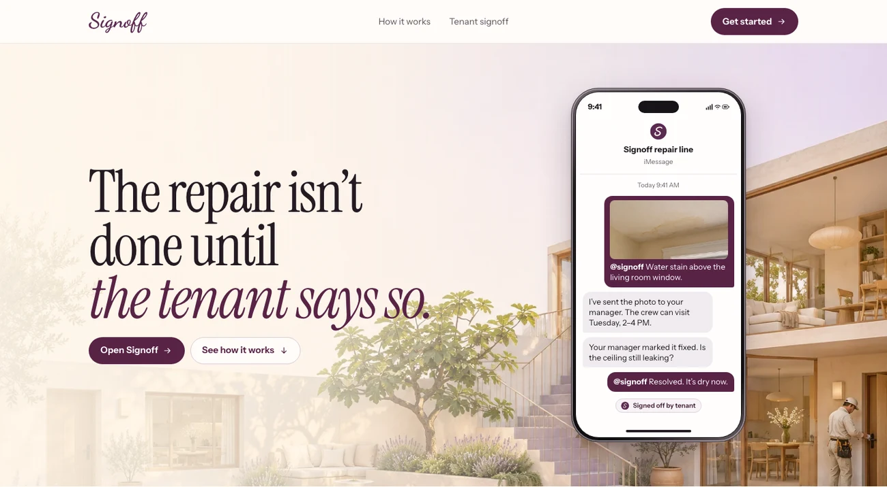
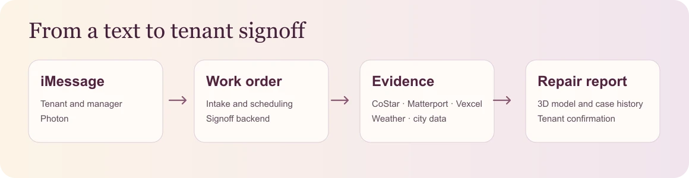

# Signoff

[](https://github.com/kacytran1122/Sign_off/actions/workflows/ci.yml)



**The repair isn’t done until the tenant says so.**

Signoff is an AI repair coordinator in iMessage. A tenant reports an issue and sends a photo. A manager receives the original photo, reviews the work order, and schedules an inspection. Signoff keeps the repair open for the tenant to confirm or reopen.

Built for **HackPrinceton 2026**.

## Why Signoff exists

A repair often starts with a text, then moves through a phone call, a calendar invite, and a maintenance ticket. The tenant can lose track of what happens, and the manager may have to piece together the address, the photo, and the affected room. Signoff keeps those details together and records the tenant’s response after maintenance marks the work complete.

## Tracks

| Track | How Signoff fits |
| --- | --- |
| **CoStar Group · Inside and Out** | Matches a CoStar building record to its Matterport scan and Vexcel roof imagery. A verified room and a calibrated roof outline help maintenance decide where to inspect first. |
| **Photon** | Receives direct iMessages, forwards the tenant’s original incident photo, and coordinates scheduling and tenant confirmation. |
| **TigerData** | Uses TimescaleDB for neighborhood heat observations and Houston 311 counts, including reports explicitly mentioning mice or rats. |

## What it does

Tenants tag `@signoff` to report a repair. Signoff keeps the photo with the request while it checks the address and asks for clarification when needed. The manager can ask about a ticket without tagging the agent. An inspection time takes effect after manager confirmation.

Each repair gets its own online report. It combines the work order state, repair guidance, the rendered 3D model, and the available building and neighborhood evidence. If the problem persists, the tenant can reopen the same work order by replying in iMessage.

## Chat commands

Replace `L-2` with the ticket number Signoff returns.

```text
Tenant   @signoff Water is dripping at [street address, city, state]. [+ photo]
Tenant   @signoff YES                         confirm a suggested address
Manager  START                                connect the manager line
Manager  What did the tenant report on L-2?   ask about an existing work order
Manager  L-2 Tomorrow 2 to 4 PM               propose an inspection
Manager  YES L-2                              confirm the proposed visit
Manager  FIXED L-2                            ask the tenant to check the repair
Tenant   @signoff Still leaking L-2           reopen a leak
Tenant   @signoff Still broken L-2            reopen other damage
Tenant   @signoff Resolved L-2                confirm the repair
```

## Architecture



The **chat assistant** in `backend/photon.ts` and `backend/workflow.ts` enrolls tenant and manager identities, keeps replies in the correct conversation, and advances the work order through scheduling and verification. Optional agents in `backend/agents/` can ask questions, propose changes, and prepare evidence briefs using scoped tools.

The **building evidence** layer verifies that the CoStar record, Matterport room and views, and Vexcel imagery all belong to the same property before it offers a roof inspection target. The **neighborhood evidence** layer uses city service records, OpenStreetMap, and Open-Meteo. TimescaleDB stores the underlying heat observations.

The **repair workspace** displays the original incident photo, work-order history, and building evidence. A separate public HTTPS host serves individual **repair reports** from private R2 snapshots. Reports are accessed through the link sent with the work order. The signed publisher filters the report data before storing the snapshot.

## Why the agent stays within the repair workflow

A model can propose an inspection window or offer repair guidance. The workflow checks the property, participant role, and current ticket state before an action can take effect. A manager confirms an inspection by replying `YES`. When the manager marks a repair fixed, the tenant still decides whether to accept the repair or reopen it.

## Building and room evidence

Signoff matches a property to its configured CoStar record. When available, Matterport provides the room measurements and interior context. A matched Vexcel roof image can help locate the exterior area above a reported incident. The link between a room and roof area gives maintenance a place to check. The source of the damage requires an on-site inspection.

## Verified run (hosted repair report)

Work order L-2 exercised a matched ceiling leak from the operating property record through a hosted report. The report showed the matched room evidence, current and seasonal outdoor heat context, an OpenStreetMap neighborhood view, Houston 311 coverage, and a wordless Blender render. The hosted page loaded at mobile and desktop widths.

## Data behind the report

**Building evidence.** `backend/scripts/import-sponsor-evidence.mjs` checks the property and its building footprints against the configured Matterport views and Vexcel imagery. The importer preserves verified room dimensions and filters unsupported roof projections.

**Outdoor heat.** Open-Meteo supplies outdoor conditions and forecast readings. The report can also show a seasonal estimate with its validation error and hourly observations stored in TimescaleDB. Indoor conditions require a measurement at the property.

**Neighborhood reports.** Houston 311 records can show nearby water, waste, or explicit rodent mentions when the source covers the location and period. Los Angeles data is shown for its available city categories. The reports describe neighborhood activity, while an on-site check can confirm conditions at the building.

## Repository

```text
backend/
  agents/       scoped intake, scheduling, evidence, and follow-up tools
  blender/      scenario-based 3D modeling and rendering
  db/           work orders, evidence, and delivery queues
  scripts/      sponsor evidence import and hosted report Worker
frontend/       Next.js landing, work-order workspace, and report views
test/           backend and browser tests
docs/           architecture and project images
```

Live links

- [Signoff landing page](https://signoffon.us/)
- Repair report links are sent in iMessage when the work order is ready.

## Run locally

Use Node 22 or later and npm. The local workspace starts its own embedded PostgreSQL server.

```bash
npm ci
npm run demo
```

Open [the local repair workspace](http://localhost:4310/app). Run the test suite with Chromium installed.

```bash
npx playwright install chromium
npm test
```

For live messaging, configure the Photon project credentials, enrolled participant handles, database, and public report origin locally. Keep the report publisher token and sponsor credentials in environment settings. `.env` files, private property configuration, and local application data are gitignored.

## Honest notes

Individual addresses receive CoStar, Matterport, and Vexcel details when Signoff has a verified match for that building. City 311 counts describe reports near the address. A Blender model shows practical temporary protection for the scenario. The hosted report remains available between updates, and new iMessages are processed by the running intake service.

Credited third-party photos retain the licenses listed on the landing page.
